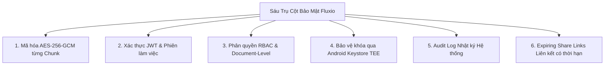

# FLUXIO OPEN SPECIFICATION: TỔNG QUAN HỆ THỐNG (SYSTEM OVERVIEW)

**Tên dự án:** Fluxio – Tối ưu hiệu năng truyền tải & Bảo mật tệp tin trong ứng dụng Android  
**Nền tảng công nghệ:** 
- **Mobile Client:** Android (Kotlin, Jetpack Compose, Room Database, WorkManager, Android Keystore / TEE)
- **Backend (Control Plane):** Spring Boot (Java 21, Spring Security, Keycloak / JWT)
- **Storage (Data Plane):** MinIO / S3-compatible Object Storage
- **Database:** PostgreSQL (Metadata, Sessions, Permissions, Audit Logs)  
**Phiên bản đặc tả:** 2.0 (Open Specification Draft)  
**Trạng thái:** Bản thiết kế kiến trúc hoàn thiện  

---

## 1. Bối cảnh & Mục tiêu Hệ thống

### 1.1. Bối cảnh
Trong môi trường di động hiện đại, việc truyền tải tệp tin dung lượng lớn (video độ phân giải cao, tài liệu nén, bản sao lưu) đặt ra hai thách thức đối nghịch:
1. **Hiệu năng & Trải nghiệm người dùng:** Mạng di động (4G/5G, Wi-Fi công cộng) có độ trễ biến động, dễ bị gián đoạn hoặc mất gói. Ứng dụng phải hỗ trợ streaming dữ liệu, chia nhỏ tệp (chunking), truyền song song đa luồng (concurrency), tiết kiệm tài nguyên bộ nhớ (tránh Out-Of-Memory do nạp toàn bộ file vào RAM) và có khả năng phục hồi tức thì (resumable transfer) mà không phải tải lại từ đầu.
2. **Bảo mật & Toàn vẹn tuyệt đối:** Dữ liệu nhạy cảm lưu trữ trên đám mây phải tuân thủ nguyên tắc Zero-Trust. Máy chủ lưu trữ (Object Storage) chỉ được phép chứa ciphertext, ngăn ngừa hoàn toàn nguy cơ rò rỉ dữ liệu khi hạ tầng lưu trữ bị xâm nhập. Đồng thời, khóa mã hóa phải được neo giữ vào phần cứng an toàn của thiết bị di động, quy trình kiểm soát truy cập phải triệt tiêu các lỗ hổng phân quyền như IDOR.

### 1.2. Mục tiêu kỹ thuật cốt lõi
- **Truyền tải phân đoạn (Chunked Transfer):** Chia tệp tin nguồn thành các phần độc lập có kích thước cố định ($5\text{ MB}$ hoặc $8\text{ MB}$ theo khuyến nghị S3 Multipart).
- **Mã hóa đầu cuối từng Chunk (End-to-End Chunk Encryption):** Mỗi chunk được mã hóa và xác thực độc lập ngay trên thiết bị trước khi rời khỏi client.
- **Tách biệt mặt phẳng điều khiển và mặt phẳng dữ liệu (Control / Data Plane Separation):** Control Plane chỉ xử lý metadata và ủy quyền; dữ liệu nhị phân mã hóa đi thẳng từ Android Client tới Object Storage qua Presigned URL.
- **Phục hồi chuyển giao mức Chunk (Chunk-Level Resumability):** Khi mất kết nối hoặc ứng dụng bị kill, client chỉ cần đối soát và truyền tiếp đúng các chunk còn thiếu thông qua Room Database và WorkManager.
- **Bảo mật phần cứng (Hardware-Backed Security):** Bảo vệ khóa chủ thông qua Android Keystore (TEE / StrongBox).

---

## 2. Lựa chọn Kiến trúc: Phương án B (Mã hóa độc lập từng Chunk)

Hệ thống Fluxio lựa chọn **Phương án B: Đọc & Mã hóa độc lập từng Chunk** thay vì mã hóa toàn bộ tệp tin trước khi chia part. Các đặc tính then chốt gồm:

1. **Đọc & Mã hóa độc lập theo Stream:**
   - Mỗi chunk được đọc trực tiếp từ con trỏ file nguồn và mã hóa tức thì bằng thuật toán `AES-256-GCM` trước khi đẩy lên MinIO.
   - Không tạo tệp tin đệm mã hóa tạm thời trên bộ nhớ flash, tối ưu hóa I/O disk và loại trừ rủi ro đầy bộ nhớ thiết bị.
2. **Tối ưu truyền tải & Phục hồi lỗi chính xác:**
   - Cho phép tải lại chính xác đúng chunk gặp lỗi mạng mà không làm ảnh hưởng tới các chunk khác hay làm vô hiệu hóa toàn bộ tệp tin.
   - Hỗ trợ resume quá trình upload/download theo từng part riêng biệt.
3. **Xác thực toàn vẹn cục bộ (Local Authenticity):**
   - Kiểm tra tính toàn vẹn tức thời cho từng chunk thông qua Authentication Tag (16 bytes) của thuật toán AES-GCM. Chunk bị can thiệp sẽ bị từ chối ngay lập tức trước khi ghép vào tệp gốc.
4. **Xử lý song song đa luồng (Concurrent Streaming):**
   - Hỗ trợ upload hoặc download song song nhiều chunk đồng thời qua coroutine pool mà không đòi hỏi phải giải mã hay mã hóa tuần tự từ đầu đến cuối tệp.

---

## 3. Sáu Trụ cột Bảo mật & Kiểm soát Dữ liệu

### 3.1. Mã hóa AES-256-GCM từng Chunk
- Mỗi tệp tin được sinh một khóa **Data Encryption Key (DEK) 256-bit** ngẫu nhiên duy nhất qua bộ sinh số ngẫu nhiên an toàn (`SecureRandom`).
- Mỗi chunk có cấu trúc bao gồm: `chunkIndex`, `nonce` (12 bytes - duy nhất cho mỗi chunk, sinh ngẫu nhiên an toàn hoặc dẫn xuất tuần tự), `ciphertext`, và `authenticationTag` (16 bytes).
- **Additional Authenticated Data (AAD):** Gắn kết chặt chẽ `fileId + chunkIndex` vào quá trình mã hóa nhằm ngăn chặn triệt để tấn công tráo đổi thứ tự (chunk reordering) hoặc tráo chunk giữa các tệp tin khác nhau.

### 3.2. Xác thực JWT (JSON Web Token)
- Quản lý phiên đăng nhập chặt chẽ với cặp token: **Access Token** ngắn hạn và **Refresh Token** có cơ chế xoay vòng (rotating refresh token).
- Tích hợp qua Spring Security và Keycloak. Toàn bộ các API thuộc Control Plane đều bắt buộc xác thực token hợp lệ.

### 3.3. Phân quyền RBAC kết hợp Document-Level Authorization
- **Role-Based Access Control (RBAC):** Phân định vai trò người dùng ở cấp hệ thống (`ADMIN`, `USER`, `GUEST`).
- **Document-Level Permission:** Kiểm tra quyền trực tiếp theo từng tệp tin (`fileId`) với các cấp độ `OWNER`, `EDITOR`, `VIEWER`. Cơ chế này loại trừ hoàn toàn lỗ hổng IDOR (Insecure Direct Object Reference) và ngăn chặn truy cập trái phép chéo giữa các người dùng.

### 3.4. Bảo vệ khóa qua Android Keystore
- Khóa chủ (Master Key / KEK - Key Encryption Key) được khởi tạo và lưu trữ an toàn trong vùng phần cứng bảo mật của thiết bị (TEE - Trusted Execution Environment hoặc StrongBox Keymaster).
- DEK phục vụ cho phiên truyền tải hoặc cache cục bộ đều được bọc (wrap/unwrap) thông qua KEK trong Android Keystore.
- **Nguyên tắc an toàn:** Tuyệt đối không lưu plaintext key vào SharedPreferences, DataStore, Room Database hay ghi vào file log/logcat. Plaintext DEK chỉ tồn tại trong bộ nhớ RAM khi đang xử lý và được zeroize ngay sau khi kết thúc.

### 3.5. Audit Log (Nhật ký kiểm toán hệ thống)
- Ghi nhận toàn diện lịch sử các tác vụ nhạy cảm trên hệ thống: đăng nhập, upload, download, cập nhật phân quyền, sinh liên kết chia sẻ, xóa tệp tin và các nỗ lực truy cập bất hợp lệ.
- Cấu trúc bản ghi nhật ký: `userId`, `fileId`, `action`, `status`, `timestamp`, `ipAddress`, `userAgent`.

### 3.6. Liên kết chia sẻ có thời hạn (Expiring Share Links)
- Khởi tạo link truy cập và tải tệp với thời gian sống có thể tùy chỉnh linh hoạt (ví dụ: 1 giờ, 24 giờ, 7 ngày).
- Tích hợp thêm các lớp bảo vệ nâng cao: mật khẩu bảo vệ (hashed password) và giới hạn số lượt tải tối đa (`maxDownloads`).
- Truy cập thông qua cơ chế Presigned URL trung gian có kiểm tra trạng thái thu hồi chủ động (active revocation).

---

## 4. Phân chia Kiến trúc: Control Plane và Data Plane

Hệ thống được tổ chức phân lập hoàn toàn giữa 2 luồng xử lý:

| Luồng xử lý | Thành phần tham gia | Chức năng chính |
| :--- | :--- | :--- |
| **Control Plane** | Android Client $\longleftrightarrow$ Spring Boot API | Quản lý metadata, khởi tạo upload/download session, cấp Presigned URLs cho từng part, điều phối xác thực/phân quyền (RBAC & Document-Level), ghi nhận Audit Log, thực hiện Complete/Abort transfer. Plaintext file **không bao giờ** đi qua Control Plane. |
| **Data Plane** | Android Client $\longleftrightarrow$ MinIO Storage | Android Client truyền trực tiếp các encrypted chunk lên MinIO qua Presigned PUT URL. Android Client tải trực tiếp các encrypted chunk từ MinIO qua Presigned GET URL (hỗ trợ HTTP Range request). |

---

## 5. Quy trình Quản lý Tiến trình & Phục hồi lỗi (Resume Transfer)

Khi ứng dụng gặp sự cố mất kết nối mạng đột ngột hoặc tiến trình bị Android OS kill do thiếu tài nguyên:

1. **Ghi nhận trạng thái tại chỗ:** Room Database cục bộ trên thiết bị lưu trữ chính xác trạng thái từng chunk đã truyền thành công (bao gồm `chunkIndex`, `nonce`, `tag`, và `etag`).
2. **Đồng bộ trạng thái khi có mạng:** Khi kết nối mạng phục hồi, Android Client gọi API `GET /api/v1/transfers/{id}/parts` để reconcile đối chiếu danh sách part giữa Client, Backend và MinIO Storage.
3. **Tải bù dữ liệu tối ưu:** Hệ thống chỉ tải lên/tải về đúng các chunk còn thiếu; bỏ qua toàn bộ các chunk đã hoàn tất mà không cần phải mã hóa hay truyền tải lại từ đầu.
4. **Thực thi bền bỉ (Persistent Execution):** Sử dụng kết hợp **WorkManager** và **Foreground Service** giúp tiến trình mã hóa và truyền tải dữ liệu chạy ổn định và an toàn ngay cả khi ứng dụng chuyển xuống chế độ chạy nền.

---

## 6. Kế hoạch Đo đạc & Benchmark Hiệu năng

Tài liệu thiết kế đặt ra tiêu chuẩn đo đạc định lượng để đánh giá hiệu năng hệ thống qua 4 chỉ số:

1. **Tối ưu bộ nhớ (Memory Footprint):** So sánh dung lượng RAM sử dụng đỉnh (Peak RAM) giữa giải pháp Streaming từng chunk vs việc Buffer toàn bộ tệp tin vào bộ nhớ.
2. **Kích thước Chunk (Throughput Evaluation):** Đánh giá băng thông và thông lượng truyền tải trên các cấu hình kích thước chunk khác nhau: $1\text{ MB}$, $4\text{ MB}$, $8\text{ MB}$, và $16\text{ MB}$.
3. **Overhead Mã hóa (Cryptographic Overhead):** Đánh giá độ chênh lệch về thời gian xử lý và CPU consumption giữa luồng có mã hóa AES-256-GCM độc lập từng chunk vs luồng không mã hóa.
4. **Độ tin cậy (Resilience & Recovery Rate):** Đánh giá thời gian phục hồi (Recovery time) và tỷ lệ truyền tải thành công của cơ chế Resumable Transfer dưới điều kiện giả lập mạng chập chờn, rớt gói.
