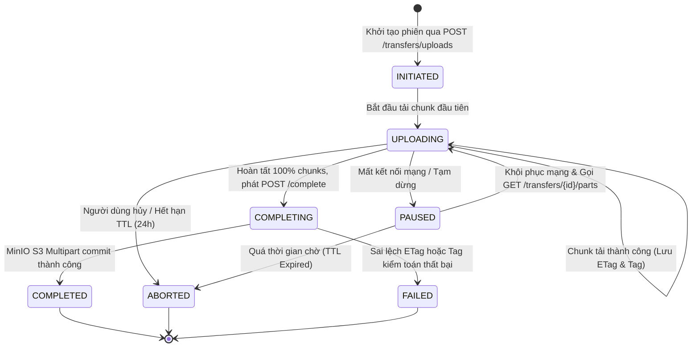
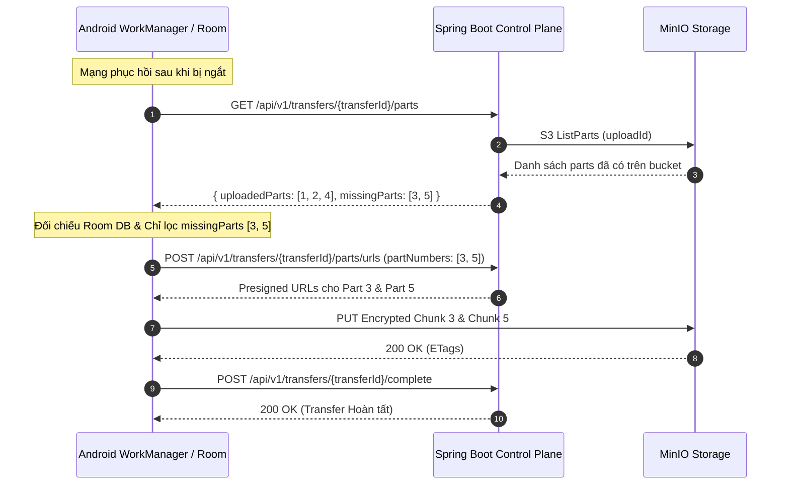

# FLUXIO OPEN SPECIFICATION: ĐẶC TẢ VÒNG ĐỜI TRUYỀN TẢI & TRẠNG THÁI (PROTOCOL LIFECYCLE & RESUME SPEC)

**Tên dự án:** Fluxio – Tối ưu hiệu năng truyền tải & Bảo mật tệp tin trong ứng dụng Android  
**Phiên bản đặc tả:** 2.0 (Open Specification Draft)  

---

## 1. Máy Trạng thái Phiên Truyền tải (Transfer Session State Machine)

Quá trình truyền tải tệp tin được quản trị chặt chẽ qua các trạng thái xác định nhằm bảo đảm tính bền bỉ và idempotency:



---

## 2. Giao thức Tải lên (Upload Protocol Sequence)

Luồng tương tác giữa **Android Client**, **Spring Boot Control Plane (Auth nội bộ)** và **MinIO Object Storage**:

```text
[Android Client]                 [Spring Boot Backend]                 [MinIO Storage]
       |                                   |                                  |
       |--- 1. POST /transfers/uploads --->|                                  |
       |    (size, chunkCount, wrappedDek) |--- S3 CreateMultipartUpload ---->|
       |                                   |<-- Trả về uploadId --------------|
       |<-- 201 Created (transferId) ------|                                  |
       |                                   |                                  |
       |--- 2. POST /parts/urls ---------->|                                  |
       |    (partNumbers: [1, 2, ...])     |--- Sinh Presigned PUT URLs ----->|
       |<-- 200 OK (presignedUrls map) ----|                                  |
       |                                   |                                  |
       |--- 3. PUT [Wire Chunk 1] ------------------------------------------->|
       |<-- 200 OK (ETag header) ---------------------------------------------|
       |    (Lưu ETag vào Room DB)         |                                  |
       |                                   |                                  |
       |--- 4. PUT [Wire Chunk 2] ------------------------------------------->|
       |<-- 200 OK (ETag header) ---------------------------------------------|
       |                                   |                                  |
       |--- 5. POST /transfers/{id}/complete -------------------------------->|
       |    (parts: [{partNumber, etag}])  |--- S3 CompleteMultipartUpload -->|
       |                                   |<-- MinIO xác nhận thành công ----|
       |<-- 200 OK (File Metadata) --------|                                  |
```

### Các bước thực thi chi tiết:
1. **Khởi tạo (Initiation):** Android Client sinh DEK ngẫu nhiên, wrap bằng KEK phần cứng (Android Keystore), sau đó gửi `fileName`, `fileSize`, `chunkSize`, `totalChunks`, `wrappedDek` lên Backend. Backend tạo bản ghi `transfer_sessions` và gọi MinIO tạo S3 `uploadId`.
2. **Cấp Presigned URL:** Client yêu cầu cấp URL tải trực tiếp cho các part đang cần truyền tải.
3. **Truyền tải Data Plane:** Client đọc stream từ file nguồn, đóng gói khung nhị phân (Nonce + Index + Ciphertext + Tag) và tải trực tiếp lên MinIO. MinIO trả về Header `ETag`. Client ghi nhận `ETag` vào cơ sở dữ liệu Room cục bộ.
4. **Xác nhận hoàn tất (Completion):** Client gửi toàn bộ danh sách `partNumber` và `etag` lên Backend. Backend đối chiếu với `ListParts` của MinIO, thực hiện lệnh `CompleteMultipartUpload`, kích hoạt bản ghi `files` trong PostgreSQL và trả về kết quả thành công.

---

## 3. Giao thức Phục hồi Tiến trình (Resumable Transfer Protocol)

Khi ứng dụng gặp sự cố (mất mạng 4G/Wi-Fi, người dùng tắt app hoặc Android OS kill tiến trình nền do tiết kiệm pin):



### Cơ chế chống lãng phí tài nguyên:
- **Không truyền lại part đã xong:** Các chunk $1, 2, 4$ đã nằm an toàn trên MinIO không cần phải đọc lại file, không cần mã hóa lại và không tốn băng thông truyền lại.
- **Tiến trình nền bền bỉ:** Cơ chế phối hợp **WorkManager** với điều kiện ràng buộc mạng (`NetworkType.CONNECTED`) đảm bảo hệ thống tự động kích hoạt lại quá trình tải bù ngay khi thiết bị có kết nối Internet trở lại.
