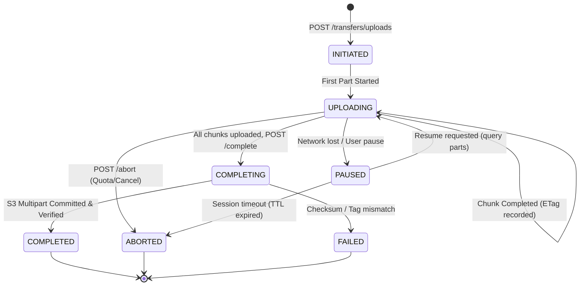

# Protocol Lifecycle & State Machine Specification

**Specification Version:** 1.0.0-draft  

---

## 1. Transfer Session State Machine

A transfer session tracks the lifecycle of an upload or download operation:



---

## 2. Upload Lifecycle Protocol

```text
[Android Client]                  [Spring Boot Control Plane]               [MinIO Object Storage]
       |                                       |                                       |
       |------- 1. POST /transfers/uploads --->|                                       |
       |        (size, chunkCount, dekWrapped) |                                       |
       |<------ 201 Created (transferId) ------|                                       |
       |                                       |                                       |
       |------- 2. POST /parts/urls ---------->|                                       |
       |        (partNumbers: [1, 2, ...])     |--- Generate Presigned URLs ---------->|
       |<------ 200 OK (presignedUrls map) ----|                                       |
       |                                       |                                       |
       |------- 3. PUT [Wire Encrypted Chunk 1] -------------------------------------->|
       |<------ 200 OK (ETag header) --------------------------------------------------|
       |                                       |                                       |
       |------- 4. PUT [Wire Encrypted Chunk 2] -------------------------------------->|
       |<------ 200 OK (ETag header) --------------------------------------------------|
       |                                       |                                       |
       |------- 5. POST /transfers/{id}/complete ------------------------------------->|
       |        (parts: [{partNumber, etag}])  |--- S3 CompleteMultipartUpload ------->|
       |                                       |<-- Commit Success --------------------|
       |<------ 200 OK (fileMetadata) ---------|                                       |
```

### Step Details:
1. **Initiate Transfer:** Client sends total plaintext size, chunk size, total chunks, and the client-wrapped DEK.
2. **Presigned URL Acquisition:** Client requests batch presigned URLs for pending parts.
3. **Direct Data Plane Transmission:** Client reads chunks from local storage, wraps in wire frame, executes AES-256-GCM, and streams binary to MinIO directly using HTTP `PUT`.
4. **Complete Transfer:** Client sends the list of part numbers with their corresponding ETags. Control Plane validates S3 list parts and commits the database entry.

---

## 3. Resumable Transfer Protocol (Failure Recovery)

When an upload is interrupted (network disconnection, crash, app process death):

1. **State Recovery:**
   - Android client wakes up (via WorkManager or user launch) and queries:
     `GET /api/v1/transfers/{transferId}/parts`
2. **Part Reconciliation:**
   - Server returns the list of parts already committed and confirmed in Object Storage:
     ```json
     {
       "transferId": "9b1deb4d-3b7d-4bad-9bdd-2b0d7b3dcb6d",
       "uploadedParts": [1, 2, 4],
       "missingParts": [3, 5]
     }
     ```
3. **Resumption:**
   - Client requests presigned URLs **only** for `missingParts` (`[3, 5]`).
   - Already uploaded parts ($1, 2, 4$) are **not** re-encrypted or re-transmitted.

