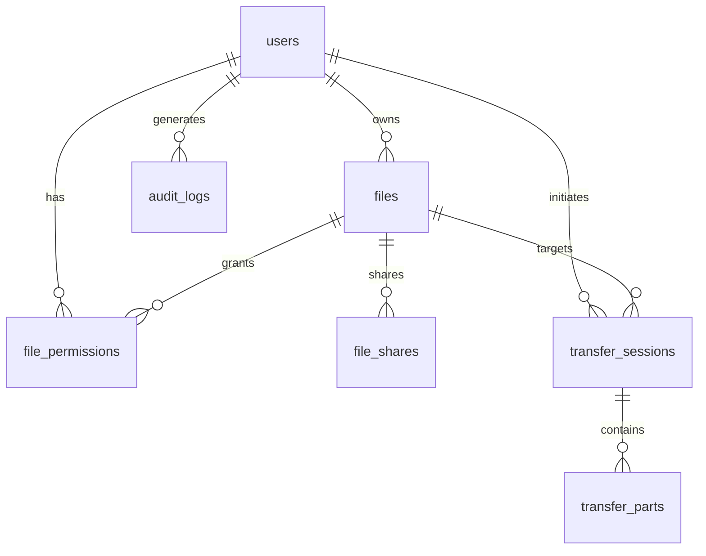

# Database Schemas & Storage Specification

**Specification Version:** 1.0.0-draft  
**Engines:** PostgreSQL 16+ (Server) & SQLite / Android Room 2.6+ (Client)  

---

## 1. Server Database Schema (PostgreSQL)

### 1.1. Entity-Relationship Overview



### 1.2. PostgreSQL Table Definitions

#### `users`
Represents system user identities and coarse RBAC roles.
* `id` (`UUID`, PK, default `gen_random_uuid()`): Unique user ID.
* `username` (`VARCHAR(64)`, UNIQUE, NOT NULL): User identity handle.
* `password_hash` (`VARCHAR(255)`, NOT NULL): BCrypt or Argon2id hashed password (managed directly by Backend Auth Service).
* `role` (`VARCHAR(32)`, NOT NULL): Global role (`ADMIN`, `USER`, `GUEST`).
* `status` (`VARCHAR(32)`, NOT NULL, DEFAULT `'ACTIVE'`): Account state (`ACTIVE`, `SUSPENDED`).
* `created_at` (`TIMESTAMPTZ`, NOT NULL, DEFAULT `NOW()`).

#### `refresh_tokens`
Native Backend JWT session & rotation management.
* `id` (`UUID`, PK, default `gen_random_uuid()`).
* `user_id` (`UUID`, FK `users(id)`, NOT NULL).
* `token_hash` (`VARCHAR(255)`, NOT NULL, UNIQUE): Hashed refresh token.
* `expires_at` (`TIMESTAMPTZ`, NOT NULL).
* `revoked` (`BOOLEAN`, NOT NULL, DEFAULT FALSE).
* `created_at` (`TIMESTAMPTZ`, NOT NULL, DEFAULT `NOW()`).

#### `files`
Metadata for stored logical files.
* `id` (`UUID`, PK): File identifier.
* `user_id` (`UUID`, FK `users(id)`, NOT NULL): Owner ID.
* `file_name` (`VARCHAR(255)`, NOT NULL): Original filename.
* `object_key` (`VARCHAR(512)`, NOT NULL, UNIQUE): Object storage path (`users/{userId}/{fileId}`).
* `bucket` (`VARCHAR(64)`, NOT NULL): MinIO bucket name.
* `content_type` (`VARCHAR(128)`, NOT NULL): MIME type.
* `file_size` (`BIGINT`, NOT NULL): Original plaintext size in bytes.
* `encrypted_dek` (`TEXT`, NOT NULL): Base64-encoded DEK wrapped under client KEK.
* `total_chunks` (`INTEGER`, NOT NULL): Total number of encrypted parts.
* `status` (`VARCHAR(32)`, NOT NULL, DEFAULT `'ACTIVE'`): State (`ACTIVE`, `TRASHED`, `DELETED`).
* `created_at` (`TIMESTAMPTZ`, NOT NULL, DEFAULT `NOW()`).
* `deleted_at` (`TIMESTAMPTZ`, NULL): Soft delete timestamp.

#### `file_permissions`
Document-level Fine-grained Access Control.
* `id` (`UUID`, PK).
* `file_id` (`UUID`, FK `files(id)`, NOT NULL).
* `user_id` (`UUID`, FK `users(id)`, NOT NULL).
* `permission` (`VARCHAR(32)`, NOT NULL): Access level (`VIEWER`, `EDITOR`).
* `granted_by` (`UUID`, FK `users(id)`, NOT NULL).
* `created_at` (`TIMESTAMPTZ`, NOT NULL, DEFAULT `NOW()`).
* **Constraint:** `UNIQUE(file_id, user_id)`.

#### `file_shares`
Expiring Public/Protected Access Links.
* `id` (`UUID`, PK).
* `file_id` (`UUID`, FK `files(id)`, NOT NULL).
* `share_token` (`VARCHAR(128)`, UNIQUE, NOT NULL): Cryptographically secure URL token.
* `expires_at` (`TIMESTAMPTZ`, NOT NULL): Link expiration cutoff.
* `password_hash` (`VARCHAR(255)`, NULL): Optional link password protection.
* `max_downloads` (`INTEGER`, NULL): Download threshold limit.
* `download_count` (`INTEGER`, NOT NULL, DEFAULT 0).
* `created_at` (`TIMESTAMPTZ`, NOT NULL, DEFAULT `NOW()`).

#### `transfer_sessions`
Active S3 Multipart Upload / Download lifecycle orchestration.
* `id` (`UUID`, PK).
* `user_id` (`UUID`, FK `users(id)`, NOT NULL).
* `file_id` (`UUID`, NULL): Associated file ID.
* `object_key` (`VARCHAR(512)`, NOT NULL): S3 Object target path.
* `upload_id` (`VARCHAR(255)`, NOT NULL): S3/MinIO Multipart Upload ID.
* `part_size` (`BIGINT`, NOT NULL): Chunk partition size (default 5MB or 8MB).
* `total_parts` (`INTEGER`, NOT NULL): Count of parts.
* `status` (`VARCHAR(32)`, NOT NULL): Session status (`INITIATED`, `UPLOADING`, `COMPLETED`, `ABORTED`).
* `expires_at` (`TIMESTAMPTZ`, NOT NULL): Session TTL.
* `idempotency_key` (`VARCHAR(128)`, NULL): Client retry deduplication key.

#### `transfer_parts`
Chunk-level tracking and verification metadata.
* `id` (`UUID`, PK).
* `session_id` (`UUID`, FK `transfer_sessions(id)`, NOT NULL).
* `part_number` (`INTEGER`, NOT NULL): 1-based part index (S3 convention).
* `nonce` (`VARCHAR(64)`, NOT NULL): Hex/Base64 12-byte GCM Nonce.
* `auth_tag` (`VARCHAR(64)`, NOT NULL): Hex/Base64 16-byte GCM Authentication Tag.
* `size` (`BIGINT`, NOT NULL): Byte size of this stored part.
* `etag` (`VARCHAR(128)`, NOT NULL): S3 Part ETag header.
* `status` (`VARCHAR(32)`, NOT NULL): Status (`PENDING`, `UPLOADED`, `VERIFIED`).
* **Constraint:** `UNIQUE(session_id, part_number)`.

#### `audit_logs`
Forensic and security audit trail.
* `id` (`BIGSERIAL`, PK).
* `user_id` (`UUID`, NULL): Acting user ID.
* `file_id` (`UUID`, NULL): Target file ID.
* `action` (`VARCHAR(64)`, NOT NULL): Event (`LOGIN`, `INIT_UPLOAD`, `DOWNLOAD`, `SHARE_CREATE`, `REVOKE_ACCESS`, `AUTH_FAILURE`).
* `status` (`VARCHAR(32)`, NOT NULL): Result (`SUCCESS`, `FAILURE`, `DENIED`).
* `ip_address` (`VARCHAR(45)`, NOT NULL): Remote IPv4/IPv6.
* `user_agent` (`TEXT`, NULL): Client device/browser user agent.
* `created_at` (`TIMESTAMPTZ`, NOT NULL, DEFAULT `NOW()`).

---

## 2. Local Database Schema (Android Room)

To guarantee resilient local state management, offline queuing, and pause/resume capability:

### 2.1. `LocalTransfer` Entity
```kotlin
@Entity(tableName = "local_transfers")
data class LocalTransfer(
    @PrimaryKey val transferId: String,       // UUID from server or local client session
    val fileName: String,
    val fileSize: Long,
    val encryptedDek: String,                 // Wrapped DEK base64
    val sourceUri: String,                     // Android content:// URI or local file path
    val status: String,                        // PENDING, IN_PROGRESS, PAUSED, COMPLETED, FAILED
    val transferredBytes: Long,
    val totalChunks: Int,
    val createdAt: Long = System.currentTimeMillis()
)
```

### 2.2. `LocalChunk` Entity
```kotlin
@Entity(
    tableName = "local_chunks",
    primaryKeys = ["transferId", "chunkIndex"],
    foreignKeys = [
        ForeignKey(
            entity = LocalTransfer::class,
            parentColumns = ["transferId"],
            childColumns = ["transferId"],
            onDelete = ForeignKey.CASCADE
        )
    ],
    indices = [Index(value = ["transferId", "chunkIndex"])]
)
data class LocalChunk(
    val transferId: String,
    val chunkIndex: Int,                      // Zero-based index
    val partNumber: Int,                      // 1-based index (for S3 multipart)
    val nonce: String,                         // Base64 12-byte Nonce
    val tag: String,                           // Base64 16-byte Tag
    val status: String,                        // QUEUED, ENCRYPTING, UPLOADING, SUCCESS, FAILED
    val etag: String? = null                   // Returned by MinIO upon PUT
)
```

