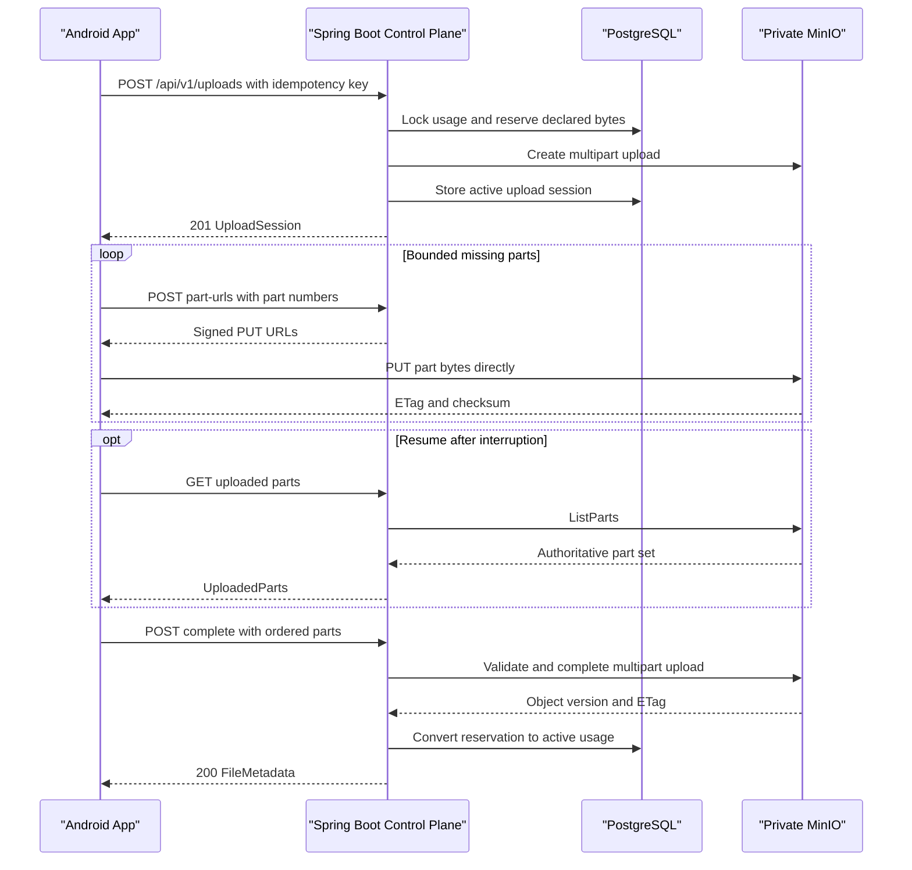

# Transfer API Contract Decisions

## Boundary

Spring Boot is the control plane. Android sends JSON metadata to Spring Boot and sends file bodies directly to private MinIO through short-lived presigned URLs. There is no API gateway, message broker, or backend file-body proxy in this change.

The machine-readable target contract is [`openapi.yaml`](./openapi.yaml). Existing `/api/v1/mvp/files` endpoints remain implementation-state only and are replaced by the target contract when this change is implemented.

## Endpoint summary

| Method | Path | Purpose | Idempotency |
|---|---|---|---|
| `POST` | `/api/v1/uploads` | Validate size/quota, reserve bytes, create MinIO multipart upload | Required key; same key and request returns same session |
| `POST` | `/api/v1/uploads/{uploadId}/part-urls` | Sign a bounded set of valid missing parts | Naturally repeatable; URLs may differ |
| `GET` | `/api/v1/uploads/{uploadId}/parts` | Return MinIO-authoritative uploaded parts | Safe and repeatable |
| `POST` | `/api/v1/uploads/{uploadId}/complete` | Validate ordered parts, complete object, finalize metadata/quota | Required key; repeats return same file |
| `DELETE` | `/api/v1/uploads/{uploadId}` | Abort multipart upload and release reservation | Repeated abort returns `204` |
| `POST` | `/api/v1/files/{fileId}/download-ticket` | Authorize ranged download and return object version | Repeatable; each call may sign a new URL |

## Contract rules

- Authentication is JWT bearer authentication. An owner-scoped resource that is missing or belongs to another user returns `404` to avoid disclosing its existence.
- `Idempotency-Key` is scoped to `(owner, operation)` and stored with a canonical request hash. Reuse with different request content returns `409`.
- A create request reserves `sizeBytes` in the same PostgreSQL transaction that creates the session. It creates no MinIO upload if the 5 GiB limit or 20 GiB quota fails.
- Signed part requests accept at most 32 unique part numbers. A part number must fit the session's calculated part count.
- MinIO `ListParts` is authoritative. Android Room state is a retry hint, not evidence that a part exists remotely.
- Completion requires consecutive part numbers starting at 1, matching ETags, and a total byte count equal to the declared file size. Only the final part may be smaller than the configured part size.
- API errors use `application/problem+json` with a stable machine-readable `code`; presigned URLs must never be included in error details or logs.
- URL expiry is returned explicitly. Clients request fresh URLs instead of retrying an expired signed request.
- Presigned URLs expire after 15 minutes. Active upload sessions expire after 24 hours without successful activity; initialization has a five-minute deadline, while a completion unresolved for two minutes is reconciled rather than expired.
- State-specific allowed operations and HTTP responses are normative in [`state-machines.md`](./state-machines.md).

## Upload and resume sequence

<!-- mermaid-checked: every participant uses `participant Id as "Label"`, no \n in aliases/messages/notes, every alt/opt/loop closed by end, no `:` inside any alias -->

## Completion failure handling

Completion crosses PostgreSQL and MinIO, so it cannot be one atomic transaction. The session first moves from `ACTIVE` to `COMPLETING`. After MinIO completes, the backend stores the resulting object version and atomically creates/activates the file, converts reserved bytes to active bytes, and marks the session `COMPLETED`.

If the process stops after MinIO completion but before PostgreSQL finalization, a repeated completion checks the deterministic object key and object metadata, then finishes the database transaction. Cleanup never aborts a `COMPLETING` session until it has reconciled whether the object already exists.

## Retry policy

- Android retries transient control-plane `408`, `429`, and `5xx` responses with capped exponential backoff and jitter; it honors `Retry-After`.
- Android retries individual failed parts, never the entire confirmed upload set.
- `4xx` contract/auth/state errors are not retried except `408`, `409` caused by an observable in-progress completion, and refreshed authorization after `401`.
- The backend uses bounded timeouts for MinIO calls and does not perform unbounded nested retries. Exact per-call timeout and backoff values remain configuration decisions to be selected during implementation/benchmarking; lifecycle deadlines are fixed in [`state-machines.md`](./state-machines.md).

