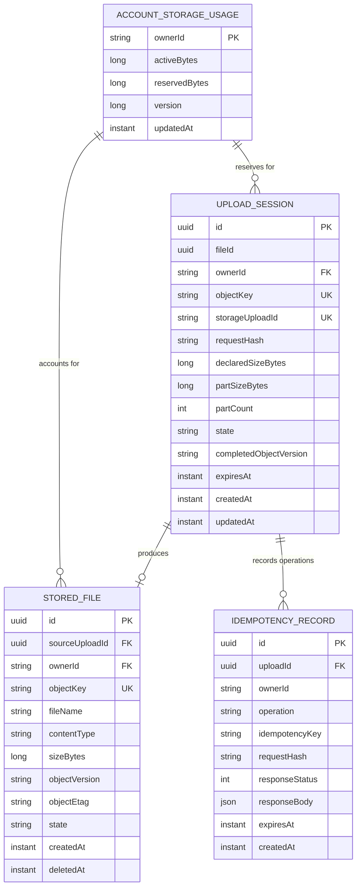

# Transfer Data Model

## PostgreSQL ownership

The Spring Boot modular monolith exclusively owns PostgreSQL metadata. MinIO exclusively owns object bytes. Database rows reference deterministic object keys but never contain presigned URLs or file bodies.

<!-- mermaid-checked: every attribute is `<type> <name> [<key>] ["<description>"]` with at most one of PK/FK/UK, no \n in descriptions, no {} in descriptions, every relationship label is double-quoted -->

## PostgreSQL invariants and indexes

| Item | Decision |
|---|---|
| Quota row | One `account_storage_usage` row per owner; update under row lock or equivalent optimistic retry |
| Quota invariant | `active_bytes >= 0`, `reserved_bytes >= 0`, and their sum never exceeds `21,474,836,480` bytes |
| File limit | `stored_file.size_bytes` and `upload_session.declared_size_bytes` are between 1 and `5,368,709,120` bytes |
| Reservation ownership | `INITIALIZING`, `ACTIVE`, and `COMPLETING` sessions contribute to `reserved_bytes`; a proven terminal transition releases or converts it once |
| Idempotency uniqueness | Unique `(owner_id, operation, idempotency_key)`; request hash mismatch is a conflict |
| File visibility | Index `(owner_id, state, created_at desc, id)` supports owner catalog queries |
| Cleanup | Index `(state, expires_at)` supports bounded expiry batches |
| Object identity | `object_key`, `storage_upload_id`, and active file object version are retained for reconciliation |
| Delete accounting | File transition from `ACTIVE` to `DELETED` decrements active bytes in the same transaction exactly once |

`owner_id` is the stable authenticated account identifier. It is intentionally not tied to the current MVP username implementation so authentication storage can evolve independently.

## Transaction boundaries

### Create upload

1. Validate declared size before calling MinIO.
2. Lock/create the owner's usage row.
3. Reject if active plus reserved plus requested bytes exceeds quota.
4. Insert the session and increment reserved bytes atomically.
5. Create the MinIO multipart upload using the deterministic object key.
6. Persist its storage upload identifier; if this fails, compensate by aborting MinIO and releasing the reservation.

The implementation may invert steps 4 and 5 only if it still guarantees that a failed quota check creates no MinIO upload and every orphan is discoverable for cleanup.

### Complete upload

Use the recovery protocol documented in [`api-contract.md`](./api-contract.md): claim `COMPLETING`, complete/reconcile MinIO, then atomically activate the file, subtract reserved bytes, add active bytes, and mark `COMPLETED`.

### Abort or expire

Claim the terminal transition with a conditional update. The winner aborts MinIO and decrements reserved bytes; repeated callers observe the terminal state without changing counters.

## Android Room model

Room stores device-local execution state only. The server and MinIO remain authoritative for ownership, quota, and confirmed parts.

| Table | Important columns | Purpose |
|---|---|---|
| `transfers` | `local_id`, `remote_upload_id`, `file_id`, `direction`, `content_uri`, `destination_uri`, `display_name`, `total_bytes`, `transferred_bytes`, `part_size_bytes`, `object_version`, `state`, `retry_count`, `next_retry_at`, `created_at`, `updated_at` | Survives process death and drives UI/WorkManager |
| `transfer_parts` | `transfer_id`, `part_number`, `offset_bytes`, `size_bytes`, `etag`, `checksum_sha256`, `state`, `attempt_count`, `updated_at` | Tracks bounded upload work and reconciliation hints |

Room constraints:

- Unique `(transfer_id, part_number)` prevents duplicate local work.
- Only one non-terminal transfer may own the same `(direction, content_uri or destination_uri)` work identity.
- Presigned URLs are never persisted; they are refreshed on demand.
- A persisted URI permission is recorded only after Android confirms it was granted. Otherwise the transfer becomes `REQUIRES_RESELECTION` after process death.
- `transferred_bytes` is derived from confirmed parts for upload and durable local bytes for download; it is not incremented from optimistic network progress.

## State values

Server upload states are `INITIALIZING`, `ACTIVE`, `COMPLETING`, `COMPLETED`, `ABORTED`, and `EXPIRED`. `INITIALIZING` makes a committed reservation discoverable while MinIO multipart creation is in progress; the API returns a session only after it reaches `ACTIVE`. File states are `ACTIVE` and `DELETED`. Android transfer states are `QUEUED`, `RUNNING`, `PAUSED`, `RECONCILING`, `COMPLETED`, `FAILED`, `CANCELLING`, `CANCELLED`, and `REQUIRES_RESELECTION`.

The normative transition tables, time limits, retryability, pause, cancellation, and download-version behavior are defined in [`state-machines.md`](./state-machines.md).

